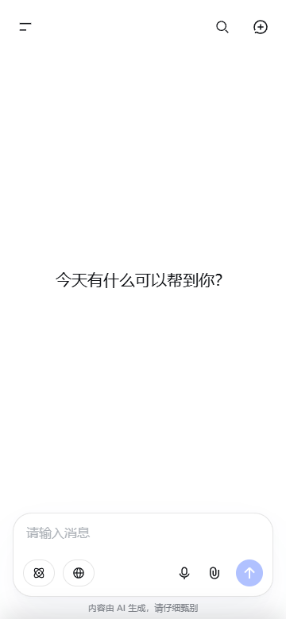

# Deepsleep

[](https://github.com/wuhedaoshi/deepsleep/actions/workflows/ci.yml)
[](LICENSE)

一个跑在 Android WebView 里的 DeepSeek 聊天客户端。前端基于官方
[chat-demo](https://github.com/deepseek-ai/DeepSeek-Chat-Demo)（MIT）二次开发，
后端就是 DeepSeek 的 Anthropic 兼容接口——没有自建服务，没有中转。



## 最终版本

| 版本 | 适合谁 | 下载与源码 |
|---|---|---|
| **稳定版 1.2.21** | 首次安装和日常使用。支持消息搜索直达、导入导出和本地历史。 | [最终 APK](https://github.com/wuhedaoshi/deepsleep/releases/download/v1.2.21/Deepsleep-1.2.21-final.apk) · [最终源码](https://github.com/wuhedaoshi/deepsleep/tree/v1.2.21-final) |
| **实验版 1.3.21** | 想使用自动上下文压缩和手动 `/compact` 的用户。 | [最终 APK](https://github.com/wuhedaoshi/deepsleep/releases/download/v1.3.21/Deepsleep-1.3.21-final.apk) · [最终源码](https://github.com/wuhedaoshi/deepsleep/tree/v1.3.21-final) |
| **进阶实验版 1.3.23** | **不适合新手。** 需要了解 DeepSeek API、Key、计费和上下文限制。 | [APK](https://github.com/wuhedaoshi/deepsleep/releases/download/v1.3.23/Deepsleep-1.3.23.apk) · [发布说明](https://github.com/wuhedaoshi/deepsleep/releases/tag/v1.3.23) |

两个 `.21` 的最终包包含搜索展开、返回残影、首页搜索和设置栏吸顶等本地修复。原发布附件为较早构建，请下载带 `-final` 的附件。

这三个 APK 共享包名 `com.deepsleep.app` 和签名。Android 的版本码分别为 145、146、148，向较高版本码更新可保留应用数据。已安装较高版本码时，Android 通常会阻止覆盖降级。切换版本前建议在设置中导出对话备份。

## 快速开始

1. 下载稳定版 APK，按 Android 提示允许安装。
2. 在 **设置 → 数据管理** 填入自己的 [DeepSeek API Key](https://platform.deepseek.com/api_keys)。
3. 新建对话发送消息。旧记录可以在 **设置 → 数据管理** 从 DeepSeek 导出 ZIP 导入。

对话和设置保存在设备上，生成回复时会把所需的上下文发送给 DeepSeek 官方 API。生成费用由你的 DeepSeek API 账号承担。

## 1.3.23 进阶设置

在 **设置 → 实验线设置** 可选择模型、思考强度、本地上下文压缩预算、安全检查和系统提示词预设。

- **全家桶（默认）** 支持读链接、联网搜索、增强安全检查及自动标题。实测开启读链接或增强检查时，单条用户消息超过 **32,768 tokens** 会被拒绝；这和多轮总上下文是两个限制。
- **标准 API** 适合长文本，省略上述扩展参数。实测同一条约 33K tokens 的纯文本请求在标准模式成功。收到单条超限提示后，可以编辑原消息，或明确选择仅本次用标准 API 重试。
- 上下文窗口设置影响应用何时压缩历史。DeepSeek Flash 和 V4 Pro 的[官方标称窗口](https://api-docs.deepseek.com/quick_start/pricing/)为 1M，应用的预算设置不会改变服务端限制。

## 它能做什么

| 能力 | 说明 |
|---|---|
| 搜索定位 | 搜索会分别列出匹配消息，点击直达并高亮，支持切到匹配的旧回答分支 |
| 完整对话历史在本地 | IndexedDB 存储，图片原件一起落盘；换机时导出 ZIP 带走 |
| **兼容官方导出格式** | 导出的是官方 `export_format_version: 3` 归档，网页版与官方客户端可直接导入；也能导入它们的导出 |
| 大包导入 | 300 MB+ / 上千条图片的归档按会话渐进写入，中断后已导入的部分仍可用 |
| 深色 / 多语言 / 语音朗读 | 跟随系统主题，简体中文与英文，Web Speech + 服务端 TTS |
| 运行日志 | 事件与计数（启动、导入进度、请求状态、错误摘要），**不含对话正文与 API Key**；写盘前脱敏。设置 → 数据管理 → 运行日志可查看/导出；文件在 `Android/data/com.deepsleep.app/files/logs/deepsleep.log`，单文件 2 MB 封顶并保留一份 `.1` 滚动 |

## 目录

```
deepsleep/
├── frontend/          React + rspack 前端（chat-demo 二次开发）
│   ├── src/           源码；services/chat/history/ 是导出导入的核心
│   └── tools/         Node 侧脚本：导入试跑、往返比对、压缩与排版的断言
├── android/           Android 工程（WebView 壳 + 本地 HTTP 服务）
│   ├── app/           MainActivity、原生桥（SAF 落盘）、Gradle 配置
│   └── build-apk.*    一条命令出包，自动递增 versionCode / versionName
├── docs/              维护手册、CHANGELOG、设计与移植笔记
└── release/           本地打好的 APK（不进仓库，用 Releases 分发）
```

## 构建

需要 JDK 17、Android SDK（platform-34 / build-tools 34.0.0）、Gradle 8.7、Node 20+、pnpm。

```bash
# 1) 前端
cd frontend
pnpm install
pnpm build            # 产出 dist/，随后由 Android 工程打进 assets/web

# 2) Android（自备签名，见下）
cd ../android
DEEPSLEEP_JDK=/path/to/jdk-17 \
DEEPSLEEP_SDK=/path/to/android-sdk \
DEEPSLEEP_GRADLE=/path/to/gradle-8.7/bin/gradle \
./build-apk.sh
# Windows: pwsh -File .\build-apk.ps1
```

**签名**：仓库里没有 keystore。自己生成一个，通过 `-Pdeepsleep.keystore`（以及
`-Pdeepsleep.storePassword` / `-Pdeepsleep.keyPassword`）传进去：

```bash
keytool -genkeypair -keystore keystore/deepsleep.keystore -alias deepsleep \
        -keyalg RSA -keysize 2048 -validity 10000
```

**版本号**：`android/version.properties` 是唯一真源，构建脚本每次 +1（`versionCode` 单调递增，
Android 靠它判升级；`versionName` 独立，可定回任意版本）。

## 技术要点

- **WebView 壳**：`MainActivity` 在 `127.0.0.1:8731` 起一个本地 HTTP 服务，静态资源来自
  `assets/web`，页面脚本经 `addJavascriptInterface` 拿到原生能力（选文件、保存到 SAF、相机、语音）。
- **流式 ZIP**：自己解析中央目录，按块解压/写入；导出经原生 SAF 直接落盘，不在内存里拼整包
  减少大归档在手机上的内存压力。
- **上下文压缩**：阈值 `floor(min(W×0.8, W−O−B))`、逐字保留 `(W−O)×0.16`，摘要提示词沿用
  8 段结构化 checkpoint；压缩指令作为最后一条 user 消息追加，复用 provider 的前缀缓存。

细节都在 [`docs/`](docs)：[`CHANGELOG.md`](docs/CHANGELOG.md)（1.0 起全部改动与原因）、
[`README.DEEPSLEEP.md`](docs/README.DEEPSLEEP.md)（工具链与已知坑）、
[`PLAN-1.3.8-COMPACTION.md`](docs/PLAN-1.3.8-COMPACTION.md)（压缩设计）。

## 免责声明

非官方客户端，与 DeepSeek 无隶属关系。使用需要自备 API Key，调用量与费用由你的账号承担。
请遵守 DeepSeek 的服务条款；导出的归档里有你的完整对话与图片，分享前自己脱敏。

## License

MIT。前端来自官方 chat-demo（Copyright © 2026 DeepSeek），修改部分归 Deepsleep contributors。
